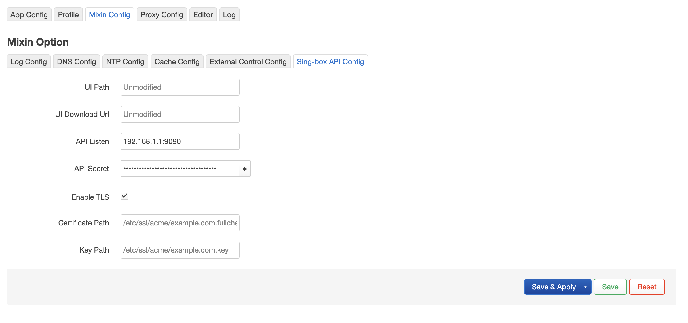
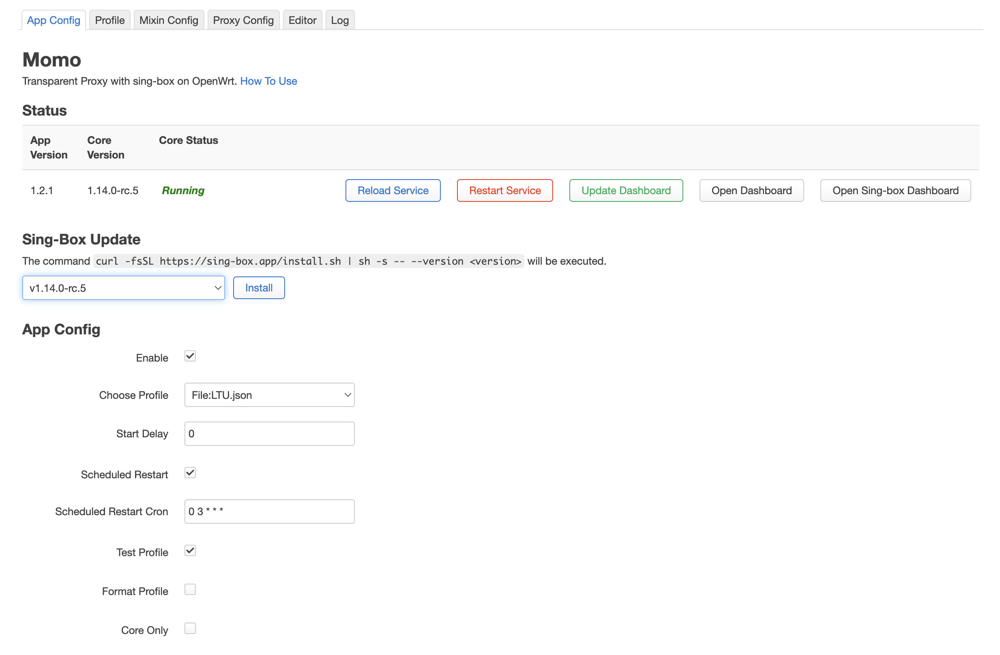
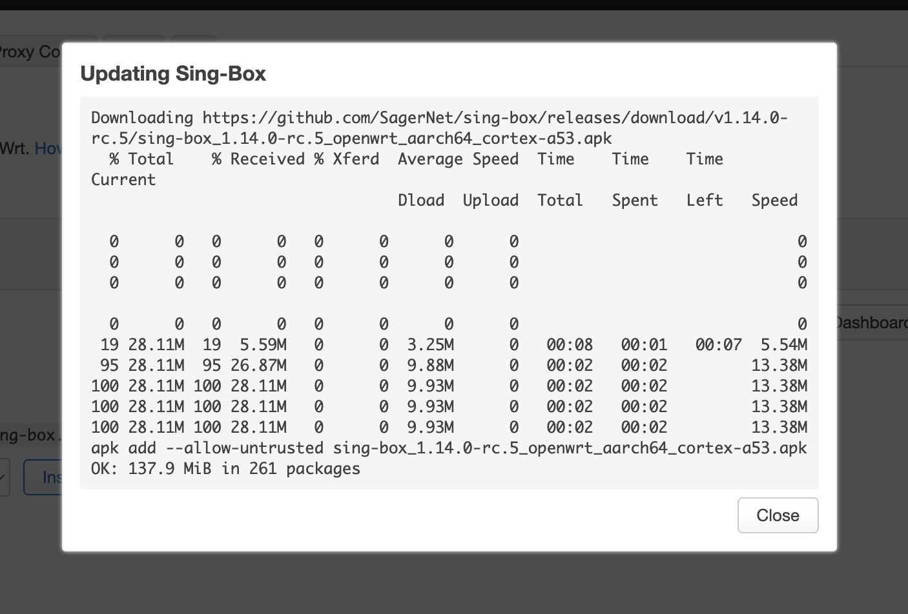
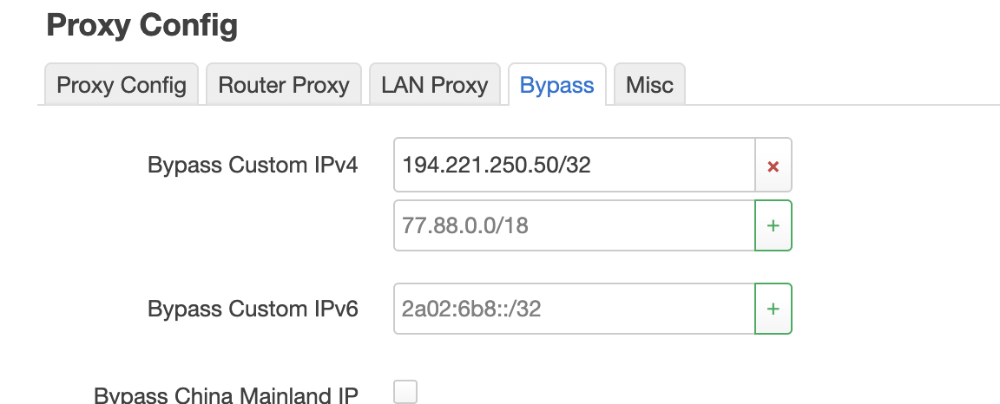

# What's new in this fork

Additions on top of the original [OpenWrt-momo](https://github.com/nikkinikki-org/OpenWrt-momo) package — the web interface and service for transparent proxying via sing-box.

## Screenshots

<table>
<tr>
<td width="50%" valign="center" align="center"></td>
<td width="50%" valign="center" align="center"></td>
</tr>
<tr>
<td width="50%" valign="center" align="center"><sub>Sing-box API Config tab in Mixin settings</sub></td>
<td width="50%" valign="center" align="center"><sub>New buttons and Sing-Box Update block</sub></td>
</tr>
<tr>
<td width="50%" valign="center" align="center"></td>
<td width="50%" valign="center" align="center"></td>
</tr>
<tr>
<td width="50%" valign="center" align="center"><sub>Sing-box update progress</sub></td>
<td width="50%" valign="center" align="center"><sub>Custom direct bypass</sub></td>
</tr>
</table>

## Installation

Pre-compiled packages are automatically built and published via GitHub Pages for the `aarch64_cortex-a53` architecture (e.g., GL.iNet Flint 2). You can add this repository to your OpenWrt router and install the packages using the `apk` package manager.

Connect to your router via SSH and run the following commands:

```sh
# Download and add the repository's public ECDSA key
wget -qO /etc/apk/keys/custom-feed.pem https://raw.githubusercontent.com/RendeRR/OpenWrt-momo/main/custom-feed.pem

# Add the custom repository to the package manager's feed list
echo "https://RendeRR.github.io/OpenWrt-momo/aarch64_cortex-a53/custommomo/packages.adb" > /etc/apk/repositories.d/custommomo.list

# Update the package index and install the application
apk update
apk add momo luci-app-momo
```

## Custom direct bypass for IPs and subnets

The **Bypass** tab now features **Bypass Custom IPv4** and **Bypass Custom IPv6** options. This allows you to specify custom single IP addresses (e.g., `194.221.250.50` or `194.221.250.50/32`) and CIDR subnets (e.g., `77.88.0.0/18`) that should bypass the sing-box proxy entirely.

Traffic routing for these destinations is handled natively at the kernel level using `nftables` named sets, skipping the sing-box core completely. This significantly reduces CPU load on the router, eliminates unnecessary processing overhead, and saves remote proxy bandwidth.

## Disable QUIC (Reject UDP 443)

A new **Disable QUIC (Reject UDP 443)** toggle is available under **Proxy Config**. When enabled, outgoing UDP port 443 traffic for proxied connections is dropped at the `nftables` mangle stage (while still respecting reserved and custom bypass IP sets). This forces browsers and apps to fall back to TCP/TLS immediately without hanging on throttled or unstable QUIC connections.

## A separate dashboard for the sing-box API

Previously, the only "Open Dashboard" button opened a web panel that worked exclusively through the Clash-compatible API. If that API was disabled in settings, there was no dashboard to open at all.

The Mixin settings now include a separate **Sing-box API Config** tab, where you can independently configure sing-box's own native API: listen address and port, access password, the web UI path and download URL, plus HTTPS with your own certificate and key. Existing entries in the profile's `services[]` array are preserved when merging the API service configuration.

A new button has appeared on the app's main page next to the old one — **Open Sing-box Dashboard**. It provides **seamless auto-login**: the router dynamically creates the dashboard directory and generates a secure proxy page (`login.html`) to pass your current API port and secret directly into the dashboard's local storage. One click opens a new tab and logs you in instantly, completely bypassing browser cross-origin (SOP) restrictions without needing to modify the dashboard's source code.

## Updating the sing-box core from the web interface

A new **Sing-Box Update** block has appeared on the app page:
- **Grouped version list**: Releases fetched from GitHub are organized into **Stable Releases** and **Pre-releases (Beta / Alpha)**, with the latest stable version selected by default and your currently installed version marked with `✓ [Installed]`.
- **Resilient downloads & GitHub mirror fallback**: The installer script is fetched directly from the official GitHub repository into `/tmp` (RAM) instead of `sing-box.app` (which may be blocked in some regions) or root flash storage. You can choose between **Auto (GitHub + Mirror Fallback)**, **Mirror (`ghfast.top`)**, **Mirror (`gh-proxy.com`)**, or **GitHub Direct** so core updates succeed even when direct access to GitHub is throttled or unreachable.

## In-editor profile validation and formatting

The **Editor** tab now includes a **Profile Tools** bar right above the text area with two actions that work on your current unsaved buffer:
- **Test Config (`sing-box check`)**: Validates the current editor content against `sing-box check` and displays the result or exact error line in a modal without restarting the running service.
- **Format JSON (`sing-box format`)**: Normalizes and formats the JSON in place using `sing-box format`.

## Checking the profile before startup

A new **Format Profile** setting lets you validate and normalize the source profile (or subscription) before your own mixin settings are applied to it — helping catch config errors earlier.

The final check before startup is also more reliable now: previously the app formatted the final config without checking whether that succeeded, and on error it could still try to start with a broken profile. Now, if formatting fails, startup stops cleanly and the reason is logged.

## Small stuff

- The "App Version" and "Core Version" fields on the status page now display more neatly — no more line wrapping.
- Fixed default `cgroup_id` alignment in `momo.init` and added safe checks when Clash API is disabled in `luci.momo`.

